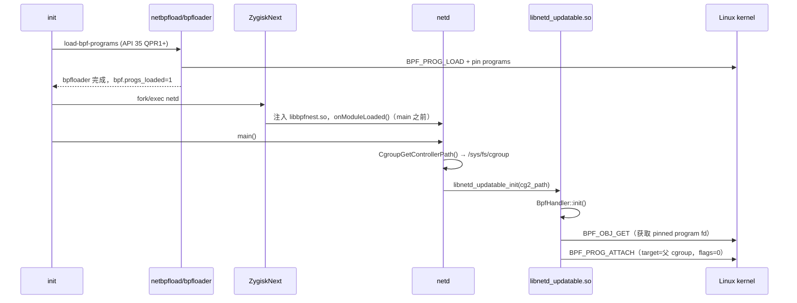

# BpfNest 预研总结报告

> 状态：预研与静态分析完成，**未编写 BpfNest 代码、未编译模块、未生成 zip、未安装、未改动设备**。
>
> 日期：2026-10-25
>
> 分析对象：
> - `/system/bin/netd`
> - `/system/lib64/libbpf_android.so`
> - `/apex/com.android.tethering/lib64/libnetd_updatable.so`

---

## 目录

1. [结论摘要](#1-结论摘要)
2. [工作区二进制身份](#2-工作区二进制身份)
3. [第一阶段：真正的 BPF 附加执行位置](#3-第一阶段真正的-bpf-附加执行位置)
4. [第二阶段：ELF 与 Hook 入口分析](#4-第二阶段elf-与-hook-入口分析)
5. [第三阶段：最小化附加参数修改策略](#5-第三阶段最小化附加参数修改策略)
6. [第四阶段：ZygiskNext API 与注入时序](#6-第四阶段zygisknext-api-与注入时序)
7. [默认模式与安全边界](#7-默认模式与安全边界)
8. [关键未知与阻塞项](#8-关键未知与阻塞项)
9. [建议的验证顺序](#9-建议的验证顺序)
10. [当前状态与下一步](#10-当前状态与下一步)
11. [附录 A：Ghidra MCP 复核补充](#附录-a-ghidra-mcp-复核补充2026-10-25)

---

## 1. 结论摘要

1. **真实附加点已定位**：不是 bpfloader，也不是 `libbpf_android.so`，而是 **netd 进程内的 `libnetd_updatable.so`**。
2. 具体调用路径：

   `netd main()` → `libnetd_updatable_init("/sys/fs/cgroup")` → `android::net::BpfHandler::init()` → `attachProgramToCgroup()` → `syscall(__NR_bpf, BPF_PROG_ATTACH, ...)`。

3. 对 ingress/egress，`attach_flags` 在二进制中确实被写成 **0**。该调用使用 `libnetd_updatable.so` 自己的 `syscall@plt`。
4. **最低侵入 Hook 点**：`libnetd_updatable.so` 的 `syscall` PLT/GOT；配套使用运行时符号解析定位 `attachProgramToCgroup`，只允许该函数内的 `BPF_PROG_ATTACH` 被处理。不要 Hook 全局 libc `syscall`，也不需要 inline hook。
5. **方案可行性**：PLT Hook 路径成立；将符合条件的目标 cgroup ingress/egress attach flags 从 `0` 改为 `BPF_F_ALLOW_MULTI`，可以让系统级子 cgroup 继续附加程序，同时保留 Android 原有程序执行。  
   但**目前不能声称问题已解决**，因为最关键的两个前提尚未在设备上验证：
   - ZygiskNext 是否能在 netd `main()` 之前完成注入；
   - `pltHook` 是否能在该 APEX 库的 RELRO PLT 上成功安装。
6. **最大风险是注入时序**：netd 启动非常早，附加发生在 `main()` 开头。如果模块在 `libnetd_updatable_init` 之后才加载，第一次附加已经完成，Hook 无法补救。
7. **版本矛盾必须先解决**：你描述设备是 Android 14，但当前三个 ELF 的 Android note 均显示 **API 35**，且二进制中的 BpfHandler 代码比 Android 15 初始 release 更新。需要确认这些文件是否确实来自当前运行系统。

---

## 2. 工作区二进制身份

当前工作区直接提供了三个设备 ELF：

| 文件 | 类型 | Android note | BuildID | SHA-256 |
|---|---|---|---|---|
| `netd` | ELF64 AArch64 PIE, stripped | Android 35 | `7890e36387e6ac0470a097ed21ecbaac` | `89dbad3d…30da1` |
| `libbpf_android.so` | ELF64 AArch64 DYN, stripped | Android 35 | `2f64b9863f2463c4eb59cfc88d39affe` | `8499a1c5…24c` |
| `libnetd_updatable.so` | ELF64 AArch64 DYN, stripped | Android 35 | `d114509ac20ab4037ed59923cfa032d5` | `9de3fc95…333` |

关键结论：

- 三个文件都是 **AArch64、小端、Android ELF**。
- `libnetd_updatable.so` 和 `libbpf_android.so` 都是 `BIND_NOW` + RELRO。
- 三者都导入 `syscall@LIBC`，但只有 `libnetd_updatable.so` 的 BPF attach 路径直接调用它。
- `libnetd_updatable.so` 带有 `.gnu_debugdata`（xz 压缩的 mini debug ELF），其中有本地符号，包括：
  - `BpfHandler::init`：`0x4250`，大小 `0xd24`
  - `attachProgramToCgroup`：`0x52d0`，大小 `0x20c`
- 这点很重要：ZygiskNext 的 `symbolLookup` 明确支持 `gnu_debugdata`，因此可以在运行时解析该本地符号，而不必完全依赖硬编码偏移。

**版本矛盾**：`file` 显示的 “for Android 35” 来自 ELF 的 Android ident note。如果设备 `ro.build.version.sdk` 是 34，则要么这些 ELF 不是当前运行的平台二进制，要么该 ROM 使用了比平台更新的 Tethering APEX/mainline 模块。二进制中的 BpfHandler 包含 connect/sendmsg/bind 等大量 attach，和 AOSP `main` 分支更接近，而不是 Android 15 初始 release。**正式实现前应重新拉取并记录 `ro.build.fingerprint`、`ro.build.version.sdk`、Tethering APEX 版本。**

---

## 3. 第一阶段：真正的 BPF 附加执行位置

### 3.1 谁加载，谁附加

| 角色 | 组件 | 证据 |
|---|---|---|
| 加载 BPF ELF、创建并 pin 程序/map | `netbpfload` + 平台 `bpfloader` | `packages/modules/Connectivity/bpf/loader/NetBpfLoad.cpp`、`netbpfload.rc`/`netbpfload.35rc`；`libbpf_android.so` 导出 `android::bpf::loadProg`；pin 路径 `/sys/fs/bpf/netd_shared/...` |
| 等待程序加载完成 | netd `BpfHandler::init` | 等待 `bpf.progs_loaded` / `mainline_done` / `init.svc.mdnsd_netbpfload` |
| 向父级 cgroup 附加 ingress/egress | `libnetd_updatable.so` 的 `BpfHandler` | mini debug 符号 + 反汇编 + AOSP `BpfHandler.cpp` |
| 执行实际 syscall | `libnetd_updatable.so` 的 `syscall@plt` | relocation `R_AARCH64_JUMP_SLOT`，GOT `0xc478`，PLT `0xac70` |

**`libbpf_android.so` 不负责 attach。** 它负责加载/读取 BPF ELF、创建 map、pin 等。它的 `syscall` PLT 不应作为本项目的 Hook 目标。

**`netd` 主程序也不负责这次 attach。** netd 自身的 `syscall` 导入用于其他路径；ingress/egress 的附加在 `libnetd_updatable.so` 中。

**`TrafficController.cpp` 不执行这个父级 cgroup attach。** 在 Android 14/15 分支中它负责 socket tagging、stats、sk destroy listener 等，没有 `BPF_PROG_ATTACH` 到 `/sys/fs/cgroup` 的逻辑。当前 main 分支甚至已不再包含该文件；设备二进制的附加逻辑仍集中在 BpfHandler。

### 3.2 调用链

### 3.3 六个问题的逐条回答

| 问题 | 结论 |
|---|---|
| 1. 谁负责加载 BPF 程序？ | `netbpfload`/`bpfloader` 负责加载和 pin；netd 只按 pin 路径取 fd，不加载字节码。 |
| 2. 谁向父级 cgroup 附加 ingress/egress？ | `android::net::BpfHandler::init()`，位于 `libnetd_updatable.so`。 |
| 3. 是否通过 `BPF_PROG_ATTACH`？ | 是。`cmd=8`，`__NR_bpf=280`，`attr` 大小 `0x98=152`。 |
| 4. 调用发生在 netd 启动哪个阶段？ | `main()` 很靠前：`CgroupGetControllerPath()` 之后、NetlinkManager/Controllers/DNS 初始化之前。 |
| 5. 实际执行 syscall 的代码属于哪个 ELF？ | `libnetd_updatable.so`，不是 `libbpf_android.so`，也不是 netd 主程序。 |
| 6. ZygiskNext 能否在首次附加前注入？ | **理论上可以，但必须在设备上证明。** netd 是 init 启动的动态 ELF 服务，启动晚于 post-fs-data；`onModuleLoaded` 在 main 之前调用。但 netd 启动很早，存在与 ZygiskNext 激活时机的竞争。 |

### 3.4 AOSP 源码对应

| 源码 | 关键内容 |
|---|---|
| `packages/modules/Connectivity/bpf/netd/BpfHandler.cpp` | `attachProgramToCgroup()` 在 58–67 行；`initPrograms()` 打开 `cg2_path`，116–117 行附加 egress/ingress；`BpfHandler::init()` 在 254 行 |
| `packages/modules/Connectivity/bpf/syscall_wrappers/include/BpfSyscallWrappers.h` | `attachProgram(..., uint32_t flags = 0)`，`.attach_flags = flags` |
| `system/netd/server/main.cpp` | 140–150 行：获取 cgroup v2 路径并调用 `libnetd_updatable_init(cg2_path)` |
| `system/netd/server/netd.rc` | `service netd ... class main` |
| `packages/modules/Connectivity/bpf/loader/netbpfload.35rc` | `exec_start bpfloader`；API 35 的加载阶段 |
| `packages/modules/Connectivity/bpf/loader/initrc-doc/README.txt` | API 35 QPR1+ 顺序：`post-fs-data` → `load-bpf-programs` → `bpf-progs-loaded` → `start netd` → `zygote-start` |
| `packages/modules/Connectivity/bpf/netd/Android.bp` | `libnetd_updatable` 构建目标，srcs 为 `BpfHandler.cpp`、`NetdUpdatable.cpp`，`apex_available: com.android.tethering` |
| `system/bpf/loader/Android.bp` | `libbpf_android` 构建目标，srcs 为 `Loader.cpp`，shared libs 为 libbase/libutils/liblog |

设备二进制实际包含的 attach 类型（包括 connect/bind/sendmsg 等）比 Android 15 初始 release 更多，说明其 Tethering APEX 可能比平台版本更新。**最终以设备二进制为准。**

---

## 4. 第二阶段：ELF 与 Hook 入口分析

### 4.1 `libnetd_updatable.so`

| 项目 | 值 |
|---|---|
| ELF | ELF64 AArch64 DYN |
| SONAME | `libnetd_updatable.so` |
| NEEDED | `libbase`、`liblog`、`libnetdutils`、`libc++`、`libc`、`libm`、`libdl` |
| 保护 | `BIND_NOW`，RELRO |
| `.text` | `0x4000`，大小 `0x6aec` |
| `.plt` | `0xaaf0` |
| `.got.plt` | `0xc3b0` |
| `syscall` relocation | GOT `0xc478`，`R_AARCH64_JUMP_SLOT` |
| `syscall` PLT stub | `0xac70` |
| `attachProgramToCgroup` | `0x52d0`，大小 `0x20c` |
| `BpfHandler::init` | `0x4250`，大小 `0xd24` |

关键反汇编：

| 地址 | 指令/含义 |
|---|---|
| `0x52d0` | `attachProgramToCgroup` 入口 |
| `0x531c`–`0x534c` | 第一次 syscall：`BPF_OBJ_GET`（cmd 7），按 pinned program 路径取 fd |
| `0x537c`–`0x53a4` | 第二次 syscall：`BPF_PROG_ATTACH`（cmd 8），`attr` 在 `sp+0x20` |
| `0x538c` | `stp w9, w8, [sp,#0x20]`：`target_fd`（cgroup fd）、`attach_bpf_fd`（program fd） |
| `0x5390` | `stp w21, wzr, [sp,#0x28]`：`attach_type`、**`attach_flags = 0`** |
| `0x53a4` | `bl 0xac70 <syscall@plt>` |
| `0x53a8` | 返回地址（LR） |

结论：**`attach_flags` 为 0 是二进制中可以直接证明的事实，不是推测。**

### 4.2 `libbpf_android.so`

| 项目 | 值 |
|---|---|
| ELF | ELF64 AArch64 DYN |
| SONAME | `libbpf_android.so` |
| `.text` | `0x4000`，大小 `0x7edc` |
| `.plt` | `0xbee0` |
| `syscall` GOT/PLT | `0x103a0` / `0xc130` |
| 导出符号 | `android::bpf::loadProg`、`readSectionUint`、`sectionNameTypes` |

它确实导入 `syscall`，但调用集中在 BPF map/program 的 load、lookup、pin 等路径，**没有 attach 入口**。因此不应在它上面安装 attach 相关 Hook。

### 4.3 `netd`

netd 主程序同样导入 `syscall`（GOT `0x91758`，PLT `0x8be30`），但其调用点不是这次父级 cgroup ingress/egress 附加。Hook netd 主程序会引入不必要的覆盖面。

### 4.4 PLT Hook 是否成立

成立，理由：

1. `libnetd_updatable.so` 的 BPF syscall 全部通过自己的 `syscall@plt` 调用；
2. 目标附加点是显式的 `bl 0xac70 <syscall@plt>`；
3. 没有发现该路径使用 inline `svc` 绕过 PLT；
4. ZygiskNext 的 `pltHook` 是 **caller-oriented**：指定库 base 和符号，只影响该库的调用方，不会污染全局。

**推荐方案**：

- Hook `libnetd_updatable.so` 的 `syscall` PLT；
- 用 `newSymbolResolver("libnetd_updatable.so", nullptr)` + `symbolLookup` 解析 `attachProgramToCgroup` 的本地符号（支持 `.gnu_debugdata`）；
- 只允许 caller LR 落在该函数范围内，且调用点前一条指令是 `bl`；
- 不 Hook `libbpf_android.so`；
- 不 Hook 全局 libc `syscall`；
- **默认不做 inline hook**。只有当设备上证实 `pltHook` 无法覆盖目标调用时，才考虑在 `0x53a4` 做精确 inline hook；那需要 execmem，风险和 SELinux 影响都更高。

### 4.5 `syscall()` 可变参数风险

`syscall` 是可变参数函数，不能用错误的 C++ 原型转发。正式实现应使用 AArch64 汇编 trampoline：

- 捕获 `x0`（syscall number）和 `x1`–`x6`（最多六个参数）；
- 捕获调用方 LR，用于 caller 校验；
- 需要 patch 时，在**线程局部副本**中修改 `bpf_attr.attach_flags`；
- 通过保存的原始 libc `syscall` 函数指针，用捕获到的六个参数原样调用；
- 保存并恢复 `errno`，保证日志记录不改变原始错误语义；
- 原样返回原始 syscall 的返回值（包括 `-1`）。

这样既保留参数，也保留 `errno` 和返回值语义。不能在 C++ 里只声明两三个参数就转发。

---

## 5. 第三阶段：最小化附加参数修改策略

### 5.1 只处理这一种请求

必须同时满足：

| 条件 | 要求 |
|---|---|
| syscall number | `__NR_bpf` = 280 |
| BPF command | `BPF_PROG_ATTACH` = 8 |
| attach type | `BPF_CGROUP_INET_INGRESS` = 0 或 `BPF_CGROUP_INET_EGRESS` = 1 |
| caller | LR 位于解析出的 `attachProgramToCgroup` 范围内，且调用点是 `bl` |
| target_fd | 经 `fstat`/cgroup2 校验，确认是配置的父级 cgroup（默认 `/sys/fs/cgroup`） |
| attr size | 至少覆盖 `attach_flags` 字段；设备实际为 152；超过本地安全上限则拒绝 patch |
| attach_flags | **必须恰好为 0** 才允许转换 |
| 现有附加状态 | 通过 `BPF_PROG_QUERY` 确认没有不兼容的既有程序 |

任何一项不满足：**原样转发**，不修改。

### 5.2 flags 处理规则

| 现有 flags | 行为 |
|---|---|
| `0` | patch 模式下可改为 `BPF_F_ALLOW_MULTI`（值 2） |
| `BPF_F_ALLOW_MULTI` 已存在 | 不重复修改，记录并原样转发 |
| `BPF_F_ALLOW_OVERRIDE` | 拒绝，绝不与 MULTI 混用 |
| `BPF_F_REPLACE` 或其他位 | 拒绝，原样转发 |
| 未知组合 | 拒绝，原样转发 |

不允许“无条件把所有 flags 替换成固定值”。

### 5.3 target_fd 验证

不能依赖 fd 数字固定。推荐：

1. 模块初始化时打开配置的父级 cgroup 路径，记录 `st_dev` + `st_ino`；
2. syscall 时对 `target_fd` 执行 `fstat`；
3. 要求它确实是 cgroup2 目录（`f_type == CGROUP2_SUPER_MAGIC`）；
4. 要求 `st_dev`/`st_ino` 与预打开父级 cgroup 一致；
5. 可选读取 `/proc/self/fd/<target_fd>` 作为诊断，但不作为唯一依据。

**Ghidra 复核更正**：`target_fd` 不是 `BPF_OBJ_GET` 的返回值。`attachProgramToCgroup` 的第一次 `BPF_OBJ_GET` 取的是 pinned program fd；`target_fd` 是 `BpfHandler::init` 中 `open(cg2_path, O_DIRECTORY | O_RDONLY | O_CLOEXEC)` 得到的普通 cgroup 目录 fd。因此 `fstat(target_fd)` 与预打开 `/sys/fs/cgroup` 的 `st_dev/st_ino` 对比在原理上成立；仍需设备实测确认。Ghidra 反编译同时显示 `attachProgramToCgroup` 第二次 syscall 的 `attr` 位于 `sp+0x20`，`attach_type`/`attach_flags` 位于 `sp+0x28`。

### 5.4 既有附加者检查

`BPF_PROG_ATTACH` 之前，用 `BPF_PROG_QUERY` 查询同一个 target_fd/type：

- 没有既有程序：允许 patch；
- 既有程序已经是 MULTI：允许追加；
- 既有程序 flags=0 或缺少 MULTI：**拒绝 patch**，原样转发；否则新旧 flags 混用会导致 `EPERM`；
- 查询失败或无权限：**拒绝 patch**，原样转发。

这是满足“同一父级 cgroup 多个附加者”要求的关键。

### 5.5 为什么用 `BPF_F_ALLOW_MULTI`，不用 `BPF_F_ALLOW_OVERRIDE`

- `BPF_F_ALLOW_MULTI`：允许同一 cgroup 和后代继续附加，所有程序共同执行；
- `BPF_F_ALLOW_OVERRIDE`：允许后代覆盖父级程序，这不是项目目标，会改变 Android 原有网络安全语义；
- 父级 Android 程序在 MULTI 模式下仍然执行；子级 systemd 程序只能增加限制，不能删除父级程序；
- 不修改 eBPF 字节码、不 detach Android 程序、不清空 map、不改内核权限检查。

### 5.6 关键运维限制

- **必须在 Android 第一次 attach 之前生效**。如果 netd 已经以 flags=0 附加过父级程序，之后再 patch 新的 attach 无法改变已有程序的 flags。
- 如果既有父级程序是 flags=0，模块不会自动 detach；自动 detach 被明确禁止。此时只能：
  - 重启设备后确保模块在 netd 启动前生效；或
  - 由你明确批准后，设计一个受控的 detach/re-attach 流程（当前不建议）。
- 如果容器层级中还有**中间祖先 cgroup**被 Android 以 flags=0 附加，单改根 cgroup 仍可能不够；需要设备端枚举所有祖先的 attach flags。

---

## 6. 第四阶段：ZygiskNext API 与注入时序

### 6.1 官方 API 事实

已读取当前官方 `zygisk_next_api.h`：

| 项目 | 内容 |
|---|---|
| API 版本 | `ZYGISK_NEXT_API_VERSION` = 4 |
| 模块结构 | `ZygiskNextModule { target_api_version; onModuleLoaded(self_handle, api); }` |
| 导出符号 | `zn_module`，default visibility |
| `onModuleLoaded` 时机 | 主程序所需库加载完成后、主程序 `main()` 之前 |
| PLT Hook | `pltHook(base_addr, symbol, hook_handler, original)`，caller-oriented |
| Inline Hook | `inlineHook(target, addr, original)`，需要 execmem |
| 符号解析 | `newSymbolResolver(path, base)`、`getBaseAddress`、`symbolLookup`（支持 gnu_debugdata）、`freeSymbolResolver` |
| Companion | `connectCompanion`，本项目暂不需要 |

当前官方 sample 使用 v1 头文件，但当前仓库头文件是 v4。**实现必须以设备上实际安装的 ZygiskNext 版本为准**；如果设备只支持旧 API，`target_api_version` 不匹配会导致模块不加载。

### 6.2 注入范围

`zn_modules.txt` 可使用绝对路径精确指定：

`path=/system/bin/netd libbpfnest.so`

这样只注入 netd，不影响 Zygote、system_server 或普通应用。模块必须是合法 Magisk 模块，`.so` 必须在模块目录内。

### 6.3 时序判断

有利因素：

- netd 是 init fork-exec 的动态 ELF 服务；
- API 35 QPR1+ 的启动顺序是 post-fs-data → load-bpf-programs → bpf-progs-loaded → start netd → zygote-start；
- `onModuleLoaded` 在 netd `main()` 之前；
- 因此理论上 Hook 可以先于 `libnetd_updatable_init()` 安装。

风险：

- netd 启动非常早，ZygiskNext 的原生服务拦截必须在 `bpf-progs-loaded` 触发前已经生效；
- 如果 ZygiskNext 在该 ROM 上对 netd 不生效，或注入发生在 `main()` 之后，第一次 attach 已经错过；
- 一旦错过，PLT Hook 无法改变已完成的 attach，只能等 netd 重启，而重启本身也未必能修复既有 flags=0 状态。

**结论：存在明确的注入时序风险，必须用设备日志证明，不能假设 Hook 一定生效。**

建议设备检查：

- `zygisk-ctl dump-zn -sa` 是否列出 netd；
- `logcat` 中 `BpfNest` 的 “module loaded” 是否早于 `libnetd_updatable_init success`；
- observe 日志是否记录到 egress/ingress 两次 attach；
- 如果只看到 “module loaded” 而没有 attach 记录，说明注入太晚或 Hook 未命中。

---

## 7. 默认模式与安全边界

建议最终实现三种模式：

| 模式 | 行为 |
|---|---|
| `observe` | 安装 Hook，记录所有符合条件的 attach 请求，**绝不修改参数**；默认模式 |
| `patch` | 仅在全部校验通过时把 `attach_flags` 从 0 改为 ALLOW_MULTI |
| `disabled` | 不安装 Hook，直接返回 |

默认必须是 `observe`，安装后不能自动进入 patch。可选实现方式：

1. 编译期默认 observe，patch 作为单独的 opt-in 构建变体；
2. 运行时读取 netd 可读的配置文件（例如 `/data/misc/net/bpfnest.mode`），读取失败则回退到编译期默认；
3. 两种方式结合，避免在某些 SELinux 配置下配置文件不可读导致模块完全失效。

不采用：

- 修改系统分区；
- 自动 detach Android 程序；
- 清空 BPF map；
- 重置网络规则；
- 放宽 SELinux；
- 全局 Hook `syscall`；
- 默认 inline hook；
- 自动启用 patch。

如果设备端 A/B 验证发现 MULTI 模式改变了 Android 原有网络限制，应立即停止 patch 模式，而不是继续放宽策略。

---

## 8. 关键未知与阻塞项

| 级别 | 问题 | 影响 |
|---|---|---|
| **阻塞** | 设备实际 Android 版本与这三个 ELF 的 API 35 不一致 | 可能分析的是错误的二进制；需重新拉取并确认 APEX 版本 |
| **阻塞** | ZygiskNext 是否在 netd `main()` 前完成注入 | 若错过首次 attach，patch 无效 |
| **阻塞** | `pltHook` 是否能在 `libnetd_updatable.so` 的 RELRO PLT 上成功 | Hook 失败则 observe/patch 都无法工作 |
| **中** | `open("/sys/fs/cgroup")` 得到的 target_fd 与模块预打开 fd 的 `st_dev/st_ino` 是否一致 | 原理上应一致；若不一致会导致 target 校验失败，patch 无法启用 |
| **低** | netd 是否有权限在 attach 时执行 `BPF_PROG_QUERY` | Ghidra 已证实 netd 在同一 cgroup fd 上使用 `BPF_PROG_QUERY`；我们的查询仍需实现验证 |
| **高** | 父级 cgroup 是否已有 flags=0 的既有程序 | 有则不能安全追加 MULTI；可能需要重启或受控 detach/re-attach |
| **高** | 容器路径上是否有中间祖先 cgroup 也被 flags=0 附加 | 仅修改根 cgroup 可能仍无法解决 systemd EPERM |
| **中** | systemd 的 EPERM 是否还来自 CAP_BPF/CAP_NET_ADMIN/SELinux/delegation | 本补丁只解决祖先进制模式冲突，不解决其他原因 |
| **中** | Android 根 ingress/egress 程序是纯统计还是也承担策略 | 需要 A/B 验证 MULTI 不削弱 Android 网络限制 |
| **中** | Tethering APEX 更新会改变函数偏移/符号 | 必须依赖运行时符号解析；硬编码偏移仅作 fallback |
| **未验证** | 所有设备端运行时行为 | 本轮没有设备测试，不能声称 systemd 问题已解决 |

---

## 9. 建议的验证顺序

### 主机侧

1. 过滤器单元测试：命令、attach type、flags、cgroup 不匹配、caller 不可信、既有程序状态、size 边界、模式解析。
2. 转发单元测试：六个参数完整保留、返回值保留、`errno` 保留、patch 只改副本、观察模式不改原 attr。
3. ARM64 汇编 trampoline 测试：本机有 `qemu-aarch64-static`，可以构建独立 AArch64 测试程序验证寄存器捕获和原始 syscall 调用。
4. ELF 静态检查：`llvm-readelf`/`llvm-objdump` 确认 AArch64、`zn_module` 导出、trampoline 指令序列、无意外依赖。

### 设备侧 A：Android 原功能

- netd 正常存活，无 native crash；
- logcat 无新 AVC；
- ingress/egress 程序仍附加；
- UID 网络限制、流量统计、Wi-Fi/蜂窝、DNS、网络共享正常。

### 设备侧 B：cgroup 层级

- 用 `bpftool cgroup show /sys/fs/cgroup` 或专用查询工具确认：
  - 父级程序仍存在；
  - attach flags 包含 MULTI；
  - 测试子 cgroup 能成功附加自己的 ingress/egress；
  - 父子程序都实际执行。
- 不能只以“程序加载成功”作为证明，必须确认 attach 成功。

### 设备侧 C：Fedora/systemd

- 只使用专用测试 service，不碰关键网络服务；
- 验证 `IPAccounting=yes`、`IPAddressAllow=`、`IPAddressDeny=`；
- 如仍 EPERM，逐项区分：父级 flags、CAP_BPF、CAP_NET_ADMIN、SELinux、cgroup delegation、cgroup namespace。

---

## 10. 当前状态与下一步

### 已完成

- 设备 ELF 架构、符号、重定位、PLT/GOT、mini debug 提取；
- 反汇编确认 `attach_flags=0` 和目标 syscall 调用点；
- Ghidra MCP 导入三个 ELF 并完成反编译复核（详见附录 A）；
- AOSP BpfHandler/BpfSyscallWrappers/netd main/bpfloader 构建定义核对；
- ZygiskNext 官方 API v4 头文件与 sample 核对；
- 注入范围、时序风险和 patch 条件设计。

### 未完成

- BpfNest 源码；
- ARM64 `.so` 编译；
- 主机测试；
- qemu 汇编测试；
- 模块 zip；
- 设备端 observe/patch 实测；
- systemd 问题复现与验证。

### 建议下一步

1. 先确认实际设备版本指纹、ZygiskNext 版本、`zygisk-ctl dump-zn -sa` 是否包含 netd；
2. 确认是否按“先 observe、设备日志证明时序后再 patch”的路线推进；
3. 再开始实现 observe-only 模块与测试；
4. 在 observe 日志确认 Hook 命中之前，**不启用 patch 模式**。

---

## 附录 A：Ghidra MCP 复核补充（2026-10-25）

本轮使用 Ghidra MCP 导入了三个 ELF，Ghidra 自动分析完成（`AARCH64:LE:64:v8A`）。Ghidra 地址 = ELF VA + `0x100000`；以下地址同时给出 ELF VA，便于与反汇编对应。

### A.1 复核结果

| 项目 | Ghidra 结果 | 结论 |
|---|---|---|
| `attachProgramToCgroup` | Ghidra `0x1052d0` / ELF `0x52d0`，大小 524；唯一调用者是 `BpfHandler::init`（Ghidra `0x104250`）；17 个调用点 | 与 ELF 符号和 `llvm-objdump` 一致 |
| `attachProgramToCgroup` syscall | Ghidra 反编译：先 `syscall(0x118, 7, &attr, 0x98)`，再 `syscall(0x118, 8, &attr, 0x98)`；attr 无 flags 参数 | 确认 `BPF_OBJ_GET` + `BPF_PROG_ATTACH`；`attach_flags` 由 zero 初始化 |
| `BpfHandler::init` | Ghidra `0x104250`，大小 3360；`strcmp(cg2_path, "/sys/fs/cgroup")`；`open(cg2_path, ...)`；egress type 1、ingress type 0 | 确认父 cgroup 路径与 attach 类型 |
| `queryProgram` | Ghidra `0x105680`，大小 184；`syscall(0x118, 0x10, &attr, 0x98)`；`prog_cnt=1`，`prog_ids=&prog_id`；返回 prog_id 或负错误 | 确认 netd 自身在同一 cgroup fd 上使用 `BPF_PROG_QUERY` |
| `libbpf_android.so` | `syscall` 的 12 个 xref 全部在 `loadProg`；无名字含 `attach` 的函数 | 确认它不负责 cgroup attach |
| `netd` | `syscall` xref 只在 `tetherStatsBpfInit`、`getTetherBpfStats`、`bpfLock`、`abortOnMismatch`、map read/write/getFirstKey/getNextKey/deleteValue；`tetherStatsBpfInit` 使用 cmd 7 | 确认 netd 主程序没有 cgroup attach 路径 |
| `libnetd_updatable::initMaps` | 仅 cmd 7（`BPF_OBJ_GET`）及 map init；无 cmd 8 | 确认 map 初始化不包含 attach |

`BpfHandler::init` 中可见的 attach 类型：

`1`（egress）、`0`（ingress）、`2`（socket create）、`10`（connect4）、`11`（connect6）、`19`（recvmsg4）、`20`（recvmsg6）、`14`（sendmsg4）、`15`（sendmsg6）、`21`（getsockopt）、`22`（setsockopt）、`34`（release）、`8`（bind4）、`9`（bind6）。

本项目只处理 `0` 和 `1`；其他类型全部原样转发。

### A.2 新增与修正结论

1. **`target_fd` 的来源已更正**：`BPF_OBJ_GET` 取的是 pinned program fd；`target_fd` 是 `BpfHandler::init` 里 `open("/sys/fs/cgroup", O_DIRECTORY | O_RDONLY | O_CLOEXEC)` 得到的普通 cgroup 目录 fd。因此 `fstat(target_fd)` 与预打开 cgroup fd 的 `st_dev/st_ino` 对比在原理上成立，不再是“BPF_OBJ_GET cgroup fd 是否同 inode”的未知项。
2. **`BPF_PROG_QUERY` 权限风险降低**：设备二进制自身在 `BpfHandler::init` 里对同一个 cgroup fd 执行多次 `queryProgram`，说明 netd 具备该查询权限。要注意的是，现有 `queryProgram` 只返回 prog_id，不返回 attach_flags；要检查既有程序是否已经是 MULTI，必须使用我们自己的 `BPF_PROG_QUERY` attr 并读取 `attach_flags` 输出。
3. **caller 校验更可靠**：`attachProgramToCgroup` 只有一个调用者 `BpfHandler::init`；17 个调用点都在该函数内。按函数范围校验 caller LR 是可行的，仍应保留“调用点前一条是 `bl`”的检查。
4. **没有第二个 attach 执行者**：`libbpf_android.so` 没有 attach 函数；netd 主程序的 syscall 只用于 tether stats/map；`initMaps` 也没有 cmd 8。当前设备二进制的 cgroup attach 集中在 `libnetd_updatable.so`。
5. **设备二进制比 Android 15 初始 release 更新**：它包含 connect/bind/sendmsg/getsockopt 等更多 attach 类型，与 AOSP main 更接近。再次说明必须使用运行时符号解析，硬编码偏移只能作为设备特定 fallback。

### A.3 Ghidra 使用注意

- Ghidra 对 `attachProgramToCgroup` 的函数签名恢复不准确：它把返回 `Status` 的 sret 指针当作 `this`，显示为 `__thiscall`。不要依赖该签名；以 syscall 调用和 attr 布局为准。
- Ghidra 导入时选择了 `v8A`，并报告 `variant_ambiguous`，候选包括 `AppleSilicon`。本轮结论已用 `llvm-objdump` 和原始字节交叉核对；对当前分析不构成问题。
- Ghidra 地址比 ELF VA 多 `0x100000`。例如 `attachProgramToCgroup` 的 Ghidra 地址是 `0x1052d0`，ELF VA 是 `0x52d0`。
